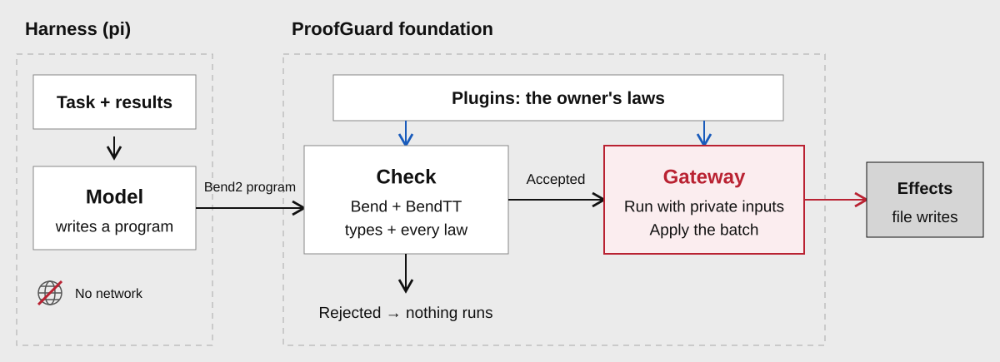
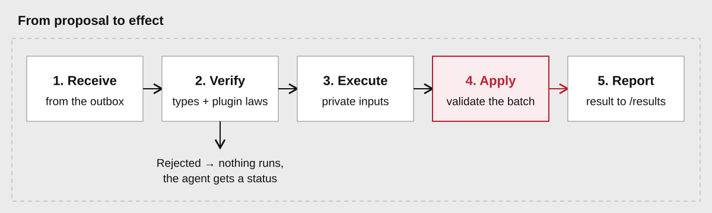

# Foundation

The foundation is the core of ProofGuard. It splits an agent's work into two sides:
on the planning side the agent writes a Bend2 program inside a sandbox; on the
execution side the owner checks that program and, if every check passes, runs it.
Plugins and harnesses attach to these two sides. The foundation names neither: it
loads plugins from their manifests and offers harnesses one module.



The agent never holds the owner's data or authority; it only describes what should
happen, as a program, and reads the result. Everything that touches private data or the outside world runs
on the execution side, after the checks.

| Piece | Code | Job |
| --- | --- | --- |
| Enrollment | `plugin.py`, `packages.py` | Loads plugins and freezes the session configuration. |
| Sandbox | `sandbox.py` | Runs the agent with no network; `/outbox` is its only writable host directory. |
| Worker | `worker.py`, `cli.py` | Pulls proposals from the outbox and publishes results. |
| Admission | `admission.py`, `bend-spec/` | Checks the source with Bend and the BendTT kernel. |
| Gateway | `gateway.py`, `effects.py`, `audit.py` | Runs accepted source, performs its effects and keeps the audit. |

## Enrollment

The owner enrolls one to sixteen [plugins](plugins.md) together with:

- `inputs_base64`: up to 16 private input snapshots the program will read;
- `session`: an identifier, an expiry time and the absolute destination file paths;
- optional per-plugin `owner_data` and source `bindings`.

Enrollment reads every plugin file once and stores the result, with the toolchain
identity, under an enrollment ID in the owner's authority directory. Later edits to
a plugin directory change nothing; a new configuration needs a new enrollment. One
enrollment serves any number of prompts and proposals until it expires. The exact
formats are in [Configuration](../reference/configuration.md).

`session.identifier` names the session's state and audit directory under the owner's
authority directory, so enrollments that reuse an identifier share their proposal
claims and audit log. An enrollment also pins the foundation's code and the
toolchain; after either changes, enroll again.

The public task, from `cli.py task`, contains only the foundation interface and
instructions. Plugin sources, law names and input bytes stay with the owner.

## The program interface

`proofguard/stdlib/program.bend` declares one function, `main : PGInputs -> PGIO`,
and the agent supplies its definition.

`proofguard/stdlib/effects.bend` defines the types it works with. Inputs and
destinations are unary indexes (`PGZero{}`, `PGNext{PGZero{}}`, …). The result is
a batch of effects. The interface currently defines one effect, writing to an
enrolled destination file:

```bend
type PGIO is Data:
  PGDone{}
  PGAbort{}
  PGWrite{destination: PGIndex, bytes: PGBytes, next: PGIO}
```

Helpers include `pg_input(index, inputs)`, `pg_write(destination, bytes)`,
`pg_text("…")`, `pg_append`, and `pg_flatten`/`pg_unflatten` for byte-by-byte
recursion. The agent can add its own helpers and datatypes but cannot redefine
anything the interface supplies. `PGAbort` cancels the whole batch.

The task's instructions spell out the rules the checker enforces. `main` may use
`inputs` once; a helper that reads several inputs declares the argument as
`+inputs`. Definitions without arguments need parentheses. A typed header,
`def main(inputs: PGInputs) -> PGIO:`, is accepted and rewritten to
`def main(inputs):` before checking.

```bend
def main(inputs):
  pg_write(PGZero{}, pg_input(PGZero{}, inputs))
```

## The sandbox

`AuthorSandbox` starts the harness's agent process with `bwrap` in new network,
PID, IPC, user and mount namespaces. The agent sees:

| Path | Access | Contents |
| --- | --- | --- |
| `/task` | read-only | The public task and the owner's brief. |
| `/runtime` | read-only | The harness's code and dependencies. |
| `/results` | read-only | Results of earlier proposals. |
| `/outbox` | read-write | Where the agent publishes proposals. |

`/tmp` (256 MiB), `/home` (64 MiB) and `/run` (8 MiB) are private, size-capped
memory filesystems, discarded when the agent exits. The environment is cleared. The
owner's authority directory, inputs, destinations and credentials are never mounted.
`AuthorSandbox.run` closes inherited file descriptors; a harness that starts
`agent_command` itself must do the same, as pi does.

`/outbox` is an ordinary host directory without a size limit. Put it on a
filesystem with a quota if the agent should not be able to fill the disk.

## From proposal to effect



1. **Receive.** The worker takes a new proposal from the outbox, marks its ID as
   claimed and reads the file once. It must be a regular UTF-8 file; links, FIFOs
   and files that change while being read are rejected. Everything after this uses
   the text read here.
2. **Verify.** Each plugin checks the source in its own context: its verifier runs
   first if it has one, then Bend and BendTT check its laws. The source is also
   checked against the foundation interface alone. All must accept.
3. **Execute.** The Bend evaluator runs that same `main` with the private
   inputs. A plugin's guard runner, if it has one, also runs and must return the
   identical batch or veto it.
4. **Apply effects.** A fixed codec decodes the batch; the host never interprets
   application logic. The gateway validates the whole batch and the expiry, then
   performs each effect. For file writes it replaces each file atomically:
   temporary file, flush, rename, flush the directory.
5. **Report.** The worker publishes `results/<id>.json`.

The gateway also keeps an append-only audit log in the owner's directory: each
check, each attempt, the planned writes and the outcome.

Steps 2 and 3 run the same text with the same pinned toolchain, so the program
that runs is the program that was checked. Processed proposal files stay in the
outbox and count toward its limit of 128 entries; above that the worker stops until
the owner cleans or rotates the outbox.

## Results

Each result file holds `schema`, `proposal`, `status`, `reason`, `source_id`,
`check_id`, `diagnostics` and `archive_durable`.

| Status | Reason | When |
| --- | --- | --- |
| `completed` | none | Every effect in the batch was performed. |
| `rejected` | `invalid_program_source` | The file could not be read as a proposal: a link, FIFO, empty or non-UTF-8 file, or one that changed while being read. |
| `rejected` | `mandatory_obligation_failed` | Verification failed. Syntax and type errors from the foundation check come with the checker's diagnostics; a plugin failure only says `Program rejected by gateway verification.` |
| `rejected` | `execution_refused` | The program was accepted but stopped before any effect: `PGAbort`, a guard veto or changed batch, an evaluator error or timeout, or a write to a destination that is not enrolled. |
| `rejected` | `session_unavailable` | The session expired before checking, or something the enrollment pinned changed, such as a plugin's verifier. |
| `uncertain` | `owner_reconciliation_required` | Something failed after the first destination was replaced. Earlier effects may have happened; the owner checks the files. |

Nothing is performed for any `rejected` result.

The worker processes each proposal ID once and never retries it. A new ID is a new
request: it is verified again and may repeat an earlier effect. After a rejection
the agent can correct its program and submit again until the session expires.

## Code map

To review the foundation, read in this order:

| File | Question |
| --- | --- |
| `proofguard/plugin.py`, `packages.py` | How are plugin sources loaded and the interface installed? |
| `proofguard/admission.py` | Can anything run without acceptance of these exact bytes? |
| `bend-spec/backend/program.mjs` | Do checking and evaluation use the same order? |
| `bend-spec/backend/io.mjs`, `proofguard/effects.py` | Does the codec only decode concrete bytes? |
| `proofguard/gateway.py` | Is every execution verified first? |
| `proofguard/worker.py` | Can a proposal change anything the owner fixed? |
| `proofguard/sandbox.py` | What can the agent reach? |
| `tests/core/` | Do the real sandbox and effect tests match these claims? |
