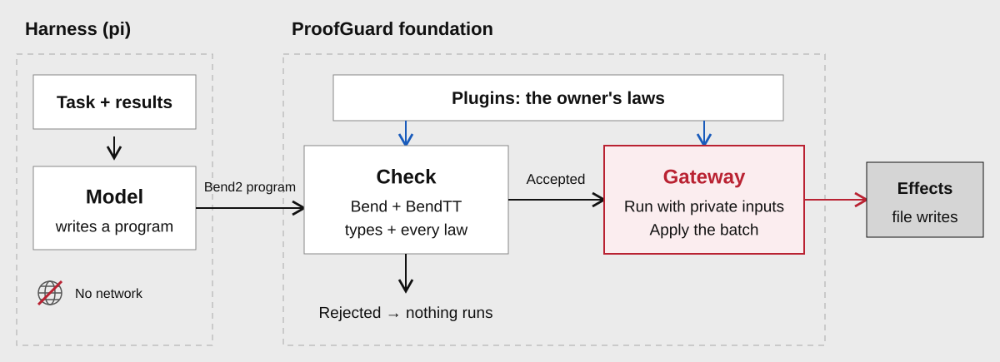

# Introduction

ProofGuard separates planning from execution for AI agents. The agent plans by
writing a Bend2 program; it never acts directly. The owner's side checks that program
against the owner's rules and, only if it passes, executes it with data and authority
the agent never holds.

The architecture has three parts. The **foundation** implements the split. **Plugins**
add the owner's rules to the checking step. **Harnesses** connect an agent runtime to
the planning step. Programs act through a fixed effect interface with two effects:
writing files and calling HTTP endpoints, both enrolled by the owner.

## How it works

1. The owner **enrolls** one or more plugins and freezes the session: private
   inputs, destination files, HTTP endpoints and a deadline.
2. The agent runs in a networkless sandbox. It reads a public task and writes a
   `main(inputs)` program to an outbox, its only writable host directory.
3. The owner's worker takes the program from the outbox. Every plugin checks its laws against
   it with Bend and the BendTT kernel, and the program must type-check against the
   foundation's interface.
4. The gateway runs that same source with the private inputs. It validates and
   performs each effect the program returns; an HTTP response goes back to the
   program, never to the agent.
5. The agent reads a short status. A plugin rejection says only that a check
   failed; syntax and type errors in the agent's own code come back so it can fix them.

## Three parts

Any plugin can be combined with any harness.

| Part | Directory | Role |
| --- | --- | --- |
| [Foundation](concepts/foundation.md) | `proofguard/`, `bend-spec/` | The planning/execution split: sandbox, outbox worker, verification, execution, effects and audit. |
| [Plugins](concepts/plugins.md) | `plugins/` | The owner's rules, written as Bend laws. [Meijer](../plugins/meijer/README.md) checks data flows. |
| [Harnesses](concepts/harnesses.md) | `integrations/` | Agent runtimes. [pi](../integrations/pi/README.md) runs the pi SDK in the sandbox. |

The foundation names no plugin or harness, and plugins and harnesses never import
each other. A harness uses one foundation module, `proofguard/session.py`.
`tests/core/test_boundaries.py` checks these rules for Python and JavaScript imports.

## Next steps

- [Quickstart](quickstart.md): install the toolchain and run a first program.
- [Foundation](concepts/foundation.md): how a program is checked and executed.
- [Write a plugin](guides/write-a-plugin.md) or [add a harness](guides/add-a-harness.md).
