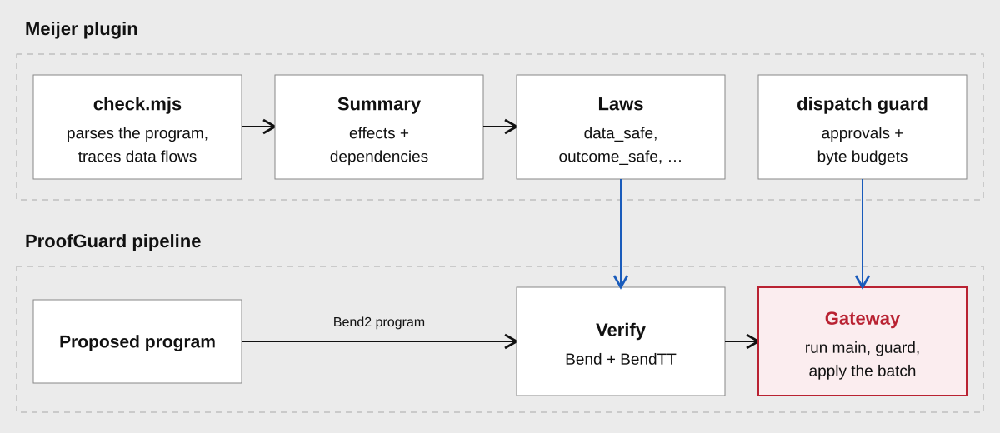

# Meijer

Meijer controls where data can flow. The owner labels each input public or private
and says which labels each destination may receive. Meijer analyzes the agent's
program and rejects it if any possible write could carry data to a destination
that may not receive it, including through helpers, transformations and branches.

## Setup

The Python helper turns the owner's settings into Bend bindings and enrolls the
plugin:

```python
from pathlib import Path
from plugins.meijer.owner.configuration import Input, Label
from plugins.meijer.owner.enrollment import MeijerPlugin

plugin = MeijerPlugin(
    inputs=(Input(b"public report", Label.PUBLIC), Input(b"private report", Label.PRIVATE)),
    clearances=(Label.PUBLIC, Label.PRIVATE),
)
selected = plugin.enroll(Path("/absolute/owner"), {
    "identifier": "reports",
    "expires": 2000000000,
    "destinations": ["/absolute/public-output", "/absolute/private-output"],
})
```

Inputs and destinations are numbered in the order given. Here input 1 is private
and only destination 1 may receive private data. The helper renders the two owner
bindings (`owner/classifications.bend`, `owner/policy.bend`) and the `owner_data`
approval tree. To use the CLI instead, write the output of
`plugin.enrollment_config(session)` to a configuration file; a hand-written entry
must supply both bindings in that order and `owner_data`. Python code needs
`PYTHONPATH=/absolute/checkout:/absolute/checkout/bend-spec`, and the authority
directory must already exist.

## Configuration

`MeijerPlugin` takes `inputs` (1–16 snapshots, each labeled `Label.PUBLIC` or
`Label.PRIVATE`; `"Public"` or `"Private"` in JSON),
`clearances` (one label per destination), an optional `context_label` (what the
planner already knew, `PUBLIC` by default) and optional `guardrails`.
`MeijerPlugin.from_config` reads the same settings from JSON. Without guardrails,
both operations are allowed, every destination is writable, there are no
preconditions, approvals or automata, and the budgets are the foundation's limits.

| Guardrail | Meaning |
| --- | --- |
| `operations` | Which of `input` and `write` the program may use. |
| `writable_sinks` | Destinations the program may write to. |
| `preconditions` | One per destination: `any`, `nonempty`, `equals_input` (the payload must equal input *n*) or `all` of up to four of these. |
| `max_writes` | At most 16 writes per proposal. |
| `max_write_bytes` | Bytes per write, up to 65,536. |
| `max_total_bytes` | Bytes per proposal, up to 1 MiB. |
| `approval_required` | Destinations that only accept an approved payload. |
| `approvals` | Up to 64 `(destination, exact payload)` pairs. |
| `automata` | Up to 4 ordering rules, each with up to 8 states. A row per state gives, for each destination, the next state after writing there, or none if that write is not allowed. Every possible trace must end in an accepting state. |

## Examples

| Program | Result |
| --- | --- |
| Input 0 to destination 0 | Accepted. |
| Input 1 to destination 1 | Accepted: destination 1 accepts private data. |
| Input 1 to destination 0, directly, transformed or through a helper | Rejected by `data_safe`. |
| Input 1 decides whether, or which constant, is written to destination 0 | Rejected by `data_safe`: control flow counts. |
| Input 1 decides whether the batch aborts | Rejected by `outcome_safe`: the agent reads every outcome. |
| A write to a destination that needs an approval, with different bytes | Vetoed by the guard before any file is written. |

```bend
# Rejected: private input 1 flows to public destination 0.
def main(inputs):
  private = pg_input(PGNext{PGZero{}}, inputs)
  pg_write(PGZero{}, private)
```

## How it works



**Analysis.** The verifier, `analysis/check.mjs`, parses the program with the pinned
Bend parser and evaluates it abstractly. Each input starts as unknown bytes tagged
with its position; no private bytes are involved. Variables, helpers, constructors,
pattern matches and applications are followed, and a match on unknown data explores
every branch, so dependencies through control flow are kept. The result is a
`PGProgramSummary`: every possible write with its destination, dependencies and
payload shape (empty, nonempty or unknown), every abort with its dependencies, and
the inputs read. The verifier binds it as `pg_program_summary`.

**Laws.** The laws in `laws/` check that summary:

| Law | Requirement |
| --- | --- |
| `scope_safe` | Referenced inputs and destinations exist. |
| `flow_safe` | The planner context's label permits every possible output. |
| `data_safe` | Data and control dependencies may reach their destinations. |
| `tools_safe` | Input reads and writes are enabled. |
| `frame_safe` | Every possible write targets a destination the owner made writable. |
| `preconditions_safe` | Known payload conditions hold; unknown ones become runtime checks. |
| `approval_safe` | Destinations that need approval have one; runtime checks compare exact bytes. |
| `budget_safe` | Worst-case writes fit the budget; runtime checks bound byte totals. |
| `sequence_safe` | Every possible trace satisfies the enrolled ordering automata. |
| `outcome_safe` | Whether a batch succeeds depends only on data the planner may see. |

`context_label` classifies what the planner already knew. A private planner
context restricts even constant outputs.

**Guard.** The `dispatch` entrypoint in `runtime/` runs after acceptance. It checks
concrete payloads against approvals, preconditions and byte budgets, and returns
the batch unchanged or aborts.

## Approvals

The helper stores exact-payload approvals in Meijer's `owner_data`, so only the
guard sees them. Each record is `Pair(Pair(destination, Blob(payload)), tail)`,
ending in `Empty`. Destinations are unary: `Empty` is destination 0 and
`Pair(Empty, n)` is destination `n + 1`. At most 64 records, destinations 0–15 and
payloads up to 65,536 bytes; a malformed list rejects. Approvals can be reused
within the enrollment.

## Layout

| Path | Contents |
| --- | --- |
| `plugin.json` | Sources, bindings, laws, verifier and guard entrypoint. |
| `analysis/` | `check.mjs` verifier and the `summary.bend` fact types. |
| `library/` | Datatypes, byte predicates and bounded counters. |
| `owner/` | Python setup helper. It renders the `owner/classifications.bend` and `owner/policy.bend` bindings. |
| `laws/` | The laws above. |
| `runtime/` | Guard runner and concrete checks. |

## Limits

Analysis allows 12,000 steps, depth 512 and 128 abstract choices; past that, or on
an unsupported construct or unknown destination, it rejects. Recursive helpers
over input bytes are accepted when they can be summarized; recursion that returns
effects is usually rejected. The analysis is conservative: it may count an input
as read when execution would not read it, so it can reject safe programs.

Because the agent reads outcomes, a check on a private payload's contents is
rejected during verification unless the payload's shape already satisfies it.
Budgets and approvals apply per proposal.

`outcome_safe` covers failures that Meijer's own checks cause: aborts, approvals,
preconditions and budgets. It does not cover failures the foundation imposes while
running the program: the 65,536-byte write limit, the evaluator's recursion limit
and timeouts. A program that writes only to a private destination can still make
its payload large, or its recursion deep, depending on private data. Whether it
then completes or is refused tells the agent about that data, about one bit per
proposal. In a session where the agent must not learn anything about private
inputs, do not rely on result statuses being independent of them.

## Tests

```sh
python3 scripts/review-tests.py plugin plugins/meijer/tests.json
```

`tests.json` maps 56 cases to tests in `plugins/meijer/tests/`, covering the
analysis, each law, real verification and real file writes.
